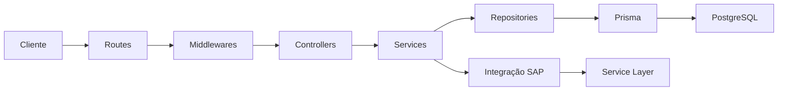

# LPSHUB API Reports

<!-- BANNER: adicione aqui a imagem do projeto quando estiver disponível. -->

> Dados do SAP Business One para relatórios, dashboards e BI, com acesso autenticado e rastreabilidade.

[Sobre](#sobre-o-projeto) · [Funcionalidades](#funcionalidades) · [Tecnologias](#tecnologias-utilizadas) · [Iniciar projeto](#iniciar-projeto) · [Como usar](#como-usar)

## Sobre o projeto

O **LPSHUB API Reports** é uma API backend que consulta o **SAP Business One Service Layer** e disponibiliza informações para aplicações web, relatórios financeiros e ferramentas de BI. Centraliza a integração SAP, a autenticação dos consumidores e o registro das operações realizadas.

Atualmente, oferece consultas de **extratos bancários, filiais e FBL5N**, verificação de conectividade SAP e administração de usuários. A integração reúne automaticamente as páginas devolvidas pelo SAP e mantém suas credenciais no servidor. O PostgreSQL armazena usuários, sessões e auditoria; os dados dos relatórios são consultados no SAP.

## Funcionalidades

- Consulta de extratos por empresa e período inclusivo ou por datas específicas.
- Listagem de filiais e verificação autenticada do Service Layer.
- Ciclo SAP de **login → operação → logout**, com tentativa de encerramento mesmo quando a consulta falha.
- Paginação automática por `odata.nextLink`, timeout e tratamento de erros externos.
- Login, consulta da conta atual e logout com sessão controlada no servidor.
- Cadastro, listagem, redefinição de senha e desativação de usuários por administradores.
- Validação de entradas, proteção HTTP e respostas de erro padronizadas em português.
- Auditoria das operações e logs estruturados correlacionados por `X-Request-ID`.
- Testes automatizados e preparação do administrador de desenvolvimento.

### Rotas e resultados

**Autenticado** significa usuário ativo com o cookie `lpshub_access_token` válido. **ADM** exige também o papel de administrador.

| Método | Rota                          | Acesso      | Resultado                                                                                   |
| ------ | ----------------------------- | ----------- | ------------------------------------------------------------------------------------------- |
| `GET`  | `/api`                        | Público     | Confirma disponibilidade HTTP: `API funcionando`.                                           |
| `GET`  | `/health`                     | Autenticado | Retorna `status: "ok"` e `API online`.                                                      |
| `POST` | `/api/v1/auth/login`          | Público     | Valida login e senha, cria sessão e envia cookie; retorna os dados públicos da conta.       |
| `GET`  | `/api/v1/auth/me`             | Autenticado | Retorna `id`, `login` e `email` da conta atual.                                             |
| `POST` | `/api/v1/auth/logout`         | Autenticado | Encerra a sessão atual, remove o cookie e retorna `success: true`.                          |
| `POST` | `/api/v1/auth/register`       | ADM         | Cria usuário ativo com papel `USER` e retorna seus dados públicos (`201`).                  |
| `GET`  | `/api/v1/auth/users`          | ADM         | Lista usuários, incluindo papel e status, sem hashes ou sessões.                            |
| `POST` | `/api/v1/auth/password-reset` | ADM         | Redefine a senha da conta identificada por login e email; retorna seus dados públicos.      |
| `POST` | `/api/v1/auth/deactivate`     | ADM         | Desativa a conta identificada por login, remove suas sessões e retorna seus dados públicos. |
| `GET`  | `/api/v1/filiais`             | Autenticado | Retorna as filiais do SAP, reunindo todas as páginas.                                       |
| `POST` | `/api/v1/extratos-bancarios`  | Autenticado | Retorna os lançamentos bancários do SAP correspondentes aos filtros.                        |
| `POST` | `/api/v1/fbl5n`              | Autenticado | Reúne os sete blocos do relatório FBL5N com os filtros informados.                          |
| `GET`  | `/api/v1/service-layer`       | Autenticado | Verifica login/logout SAP e retorna `Service Layer funcionando`.                            |

Contratos completos: [especificação da API](docs/api-specification.md) e [guia de rotas](documentação.md#rotas).

### Segurança

- **Senhas:** hash com `crypto.scrypt`, salt aleatório por senha e comparação com `timingSafeEqual`. Senhas e hashes não integram as respostas.
- **Autenticação:** JWT HS256 assinado com chave de ambiente, associado a uma sessão PostgreSQL. O cookie usa `HttpOnly`, `SameSite=Strict`, `Path=/` e `Secure` em produção.
- **Sessões:** expiram após **2 horas de inatividade** ou **8 horas de duração total**. Logout revoga a sessão atual; desativação revoga todas as sessões da conta em uma transação.
- **Autorização:** apenas login e `GET /api` são públicos. Operações administrativas exigem `ADM`; novas contas recebem `USER`.
- **Validação:** Zod verifica entradas antes dos controllers e rejeita campos não previstos. JSON limitado a **2 KB** nas rotas de autenticação e **10 KB** em extratos.
- **Proteção HTTP:** Helmet, CORS por lista de origens e HTTPS obrigatório em produção, com configuração explícita dos proxies confiáveis.
- **Limites por IP:** 50 requisições/minuto globalmente; limites adicionais de 15 para login e cadastro e 5 para redefinição de senha. Excesso retorna `429`.
- **Dados sensíveis:** remoção de campos sensíveis conhecidos nas respostas SAP, filtragem de logs e metadados de auditoria controlados.


### Auditoria das rotas

> **A auditoria está implementada em todas as rotas. Ainda não existe endpoint HTTP para consultar seu histórico.** O evento `AUDIT_LOG_VIEWED` está previsto para uma futura consulta administrativa.

O middleware global identifica a operação pelo catálogo `AUDITED_ROUTES`; os services complementam o evento e o `auditService` encaminha a gravação para o repository, Prisma e tabela **`AuditLog`**. O middleware executa antes das validações e da autenticação para incluir falhas antecipadas.

São registrados usuário, data em UTC, IP, user agent, rota, método, ação semântica, sistema de destino, status, duração e informações resumidas da resposta. Um UUID interno, devolvido em `X-Request-ID`, relaciona a auditoria aos logs do **Pino**.

Por exemplo, extratos geram `REPORT_EXECUTED`, ação `BANK_STATEMENT_SEARCH` e destino `SAP_B1`. Bodies completos e conteúdo financeiro não são duplicados; a referência de sessão é transformada com SHA-256.

A aplicação oferece somente inserção no histórico. A resposta aguarda a tentativa de persistência, exceto em login/logout, que gravam de forma assíncrona. Se a gravação falhar, o Pino registra `AUDIT_PERSISTENCE_FAILED` e a resposta é concluída.

### Banco de dados

O **PostgreSQL**, acessado pelos repositories com **Prisma ORM**, contém três modelos principais:

| Modelo        | Conteúdo e relações                                                                                                                             |
| ------------- | ----------------------------------------------------------------------------------------------------------------------------------------------- |
| `User`        | Login e email únicos, hash da senha, status, papel `ADM`/`USER` e datas de criação/atualização.                                                 |
| `UserSession` | Identificador de sessão, usuário, criação e última atividade. Relação de muitas sessões para um usuário, com exclusão em cascata.               |
| `AuditLog`    | Histórico das operações, UUIDs, ator, resultado e `metadata` JSONB filtrado. Guarda o usuário como snapshot, sem chave estrangeira para `User`. |

Os enums `UserRole`, `AuditEventType` e `AuditAction` padronizam papéis e operações. A auditoria possui índices por data, usuário, requisição, evento, ação, rota, sucesso e IP. Alterações estruturais são mantidas em `prisma/migrations/`.

Consulte o [schema Prisma](prisma/schema.prisma) e a [documentação do banco](docs/database.md).

### Arquitetura e pastas



```text
src/
├── config/         # Ambiente, autenticação, logger, limites e catálogo de auditoria
├── controllers/    # Entrada e resposta HTTP
├── integrations/   # Comunicação, sessão e paginação SAP
├── middlewares/    # Autenticação, autorização, validação, logs, auditoria e erros
├── repositories/   # Acesso ao PostgreSQL via Prisma
├── routes/         # Endpoints e associação dos middlewares/controllers
├── services/       # Regras de negócio e coordenação das operações
├── utils/          # Helpers técnicos, criptografia e eventos
├── validations/    # Schemas Zod
├── app.js          # Montagem do Express
└── server.js       # Inicialização do servidor
prisma/             # Schema e migrations
scripts/            # Preparação do ambiente local
tests/              # Testes automatizados
docs/               # Arquitetura, contratos, regras, banco, integrações e decisões
```

## Tecnologias utilizadas

| Tecnologia                            | Aplicação                                                       |
| ------------------------------------- | --------------------------------------------------------------- |
| **Node.js + JavaScript ES Modules**   | Runtime e organização dos módulos.                              |
| **Express 5**                         | API HTTP e middlewares.                                         |
| **SAP Business One Service Layer**    | Origem dos dados dos relatórios, via `fetch` nativo.            |
| **PostgreSQL 16 + Prisma 6**          | Persistência, modelagem e migrations.                           |
| **Zod**                               | Validação dos contratos de entrada.                             |
| **Helmet, cors e express-rate-limit** | Headers de segurança, origens autorizadas e limites de tráfego. |
| **node:crypto**                       | scrypt, JWT HS256, SHA-256 e identificadores aleatórios.        |
| **Pino, pino-http e pino-pretty**     | Logs JSON e apresentação no terminal de desenvolvimento.        |
| **AsyncLocalStorage**                 | Contexto compartilhado entre operações da mesma requisição.     |
| **Docker Compose**                    | PostgreSQL local com volume persistente.                        |
| **dotenv, nodemon e node:test**       | Configuração, reinício em desenvolvimento e testes.             |

## Pré-requisitos

- **Node.js e npm**. A documentação registra uso de Node.js 24; o projeto ainda não fixa uma versão em `engines`.
- **Git** para clonar o repositório.
- **Docker com Compose** para iniciar o PostgreSQL local, ou uma instância PostgreSQL acessível.
- Acesso de rede e credenciais do **SAP Business One Service Layer**. A consulta de filiais depende da SQLQuery `LpsHub-GetDadosFiliais`; a FBL5N depende das sete SQLQueries com filtro de cliente e das sete cópias com sufixo `_BASE` para consultas sem cliente, cadastradas no SAP. `npm run fbl5n:sqlqueries` gera os textos de referência.

## Iniciar projeto

### 1. Clonar e instalar

Os exemplos abaixo usam Bash, disponível também no Git Bash/WSL no Windows.

```bash
git clone https://github.com/yolmat/Lpshub-Reports.git LPSHUB-API-Reports
cd LPSHUB-API-Reports
npm ci

# Preserva um .env que já exista.
if [ ! -f .env ]; then cp .env.example .env; fi
```

### 2. Configurar o `.env`

Preencha os valores de [.env.example](.env.example) no `.env` local. Nunca versione credenciais.

| Variável                       | Configuração                                                                                                                                            |
| ------------------------------ | ------------------------------------------------------------------------------------------------------------------------------------------------------- |
| `PORT`                         | Porta da API; os exemplos usam `3000`. Sem configuração, o código usa `3002`.                                                                           |
| `NODE_ENV`                     | `development` localmente; `production` ativa HTTPS obrigatório, cookie seguro e logs JSON.                                                              |
| `DATABASE_URL`                 | Conexão no formato `postgresql://<usuario>:<senha>@localhost:5438/<banco>` para o Compose local. Codifique caracteres especiais das credenciais na URL. |
| `JWT_SECRET`                   | Chave secreta imprevisível com pelo menos 32 caracteres para assinatura JWT.                                                                            |
| `PASSWORD_RESET_DEFAULT`       | Senha aplicada pela redefinição administrativa; não é devolvida pela API.                                                                               |
| `CORS_ALLOWED_ORIGINS`         | Origens do frontend separadas por vírgulas, sem caminhos. Vazio não autoriza origens externas.                                                          |
| `TRUST_PROXY`                  | Quantidade de proxies confiáveis; use `0` no acesso local direto.                                                                                       |
| `SAP_SERVICE_LAYER_URL`        | URL base do servidor SAP; a integração monta os caminhos `/b1s/v1/`.                                                                                    |
| `SAP_SERVICE_LAYER_COMPANY_DB` | Banco da empresa no SAP.                                                                                                                                |
| `SAP_SERVICE_LAYER_USERNAME`   | Usuário técnico SAP.                                                                                                                                    |
| `SAP_SERVICE_LAYER_PASSWORD`   | Senha do usuário técnico SAP.                                                                                                                           |
| `SAP_SERVICE_LAYER_TIMEOUT_MS` | Timeout por chamada SAP. O exemplo e o fallback do código definem `1800000` ms (30 minutos).                                                    |
| `FULL_TEST_ADMIN_LOGIN`        | Login do administrador local preparado por `fullTest`.                                                                                                  |
| `FULL_TEST_ADMIN_EMAIL`        | Email desse administrador.                                                                                                                              |
| `FULL_TEST_ADMIN_PASSWORD`     | Senha desse administrador; obrigatória apenas para `fullTest`, assim como login e email.                                                                |

### 3. Iniciar o PostgreSQL

```bash
docker compose up -d lpshub
docker compose ps
docker compose exec lpshub pg_isready
```

O Compose inicia **somente o banco**, usando `postgres:16-alpine`, porta local **5438** e volume persistente `lpshubReports`. A API roda separadamente pelo npm. Faça `DATABASE_URL` corresponder ao usuário, senha e banco definidos no Compose: o arquivo não os obtém automaticamente dessa URL.

### 4. Preparar o schema e o Prisma Client

> **Instalação do zero:** o histórico atual cria `UserSession` e sua referência a `User` antes da migration que cria `User`. Por isso, as migrations falham em um banco completamente vazio. Esse histórico precisa de correção específica antes de uma instalação integral do zero. Veja a [limitação documentada](docs/database.md#6-migrations).

Para um banco já provisionado com histórico compatível:

```bash
npx prisma migrate status
npx prisma migrate deploy
npm run prisma:generate
```

Não marque migrations como aplicadas sem executar suas operações. A geração do Prisma Client não cria as tabelas.

### 5. Preparar o administrador e iniciar a API

Com banco e schema preparados e as variáveis `FULL_TEST_ADMIN_*` preenchidas:

```bash
npm run fullTest
```

Esse comando verifica a conexão, cria ou atualiza o administrador local e inicia `npm run dev`. **A cada execução, reaplica a senha configurada e reativa a conta.** Use um banco de desenvolvimento. Ele não sobe o Docker, não aplica migrations e não executa a suíte de testes.

Com o usuário já preparado, inicie diretamente:

```bash
npm run dev
```

Em outro terminal, com `PORT=3000`:

```bash
curl http://localhost:3000/api
```

Resposta: `{"message":"API funcionando"}`. Depois do login, use `/api/v1/service-layer` para verificar o SAP.

### Comandos úteis

| Comando                                              | Finalidade                                                              |
| ---------------------------------------------------- | ----------------------------------------------------------------------- |
| `npm start`                                          | Iniciar sem reinício automático.                                        |
| `npm test`                                           | Executar a suíte com `node --test`.                                     |
| `npm run prisma:studio`                              | Abrir a interface local de inspeção do banco.                           |
| `npm run prisma:migrate -- --name nome_da_alteracao` | Criar/aplicar migrations em desenvolvimento, com histórico consistente. |
| `docker compose stop`                                | Parar o banco local preservando seus dados.                             |

Os testes cobrem autenticação, autorização, segurança HTTP, validações, auditoria, logs, preparação local e integração SAP simulada. Há teste de persistência de auditoria que usa PostgreSQL real: prepare um banco de testes e o Prisma Client antes de executar a suíte.

Para produção, configure HTTPS em um proxy reverso e ajuste `TRUST_PROXY`; `npm start` não configura TLS nem define `NODE_ENV`. O `@prisma/client` está atualmente em `devDependencies`, embora seja necessário em execução: a instalação precisa incluí-lo e gerar o cliente.

## Como usar

### Autenticar e consultar

Exemplo local com dados fictícios: substitua login e senha pelos da conta preparada. O arquivo de cookies contém a sessão e deve permanecer fora do versionamento.

```bash
BASE_URL=http://localhost:3000
COOKIE_FILE=$(mktemp)

curl -i -c "$COOKIE_FILE" -X POST "$BASE_URL/api/v1/auth/login" \
  -H 'Content-Type: application/json' \
  -d '{"login":"admin.local","senha":"SUA_SENHA_LOCAL"}'

curl -b "$COOKIE_FILE" "$BASE_URL/api/v1/auth/me"
curl -b "$COOKIE_FILE" "$BASE_URL/api/v1/filiais"
curl -b "$COOKIE_FILE" "$BASE_URL/api/v1/service-layer"
```

A autenticação utiliza **cookie**; não há suporte a `Authorization: Bearer` nas rotas atuais. Em um frontend autorizado por CORS, envie as requisições com `credentials: "include"`, respeitando a política `SameSite=Strict`.

### Consultar extratos bancários

Substitua a sigla ilustrativa por uma empresa válida do seu ambiente:

```bash
curl -b "$COOKIE_FILE" -X POST "$BASE_URL/api/v1/extratos-bancarios" \
  -H 'Content-Type: application/json' \
  -d '{"empresa":["SIGLA"],"dataInicial":"2026-10-01","dataFinal":"2026-10-13"}'
```

Para datas específicas, utilize este body:

```json
{
  "empresa": ["SIGLA"],
  "datas": ["2026-10-01", "2026-10-13"]
}
```

`empresa` é obrigatório. `datas` preenchido tem prioridade sobre o período; quando ausente ou vazio, informe `dataInicial` e `dataFinal`. As datas seguem `AAAA-MM-DD`, e o intervalo inclui ambos os limites. A API retorna `{"success":true,"data":[...]}` com os registros encontrados, reunindo as páginas SAP.

### Encerrar a sessão

```bash
curl -b "$COOKIE_FILE" -c "$COOKIE_FILE" -X POST "$BASE_URL/api/v1/auth/logout"
rm -- "$COOKIE_FILE"
```
